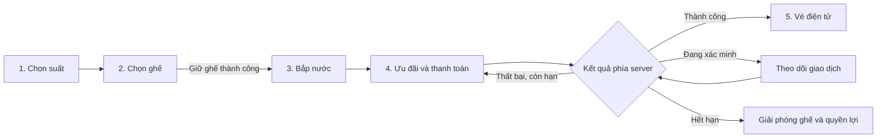
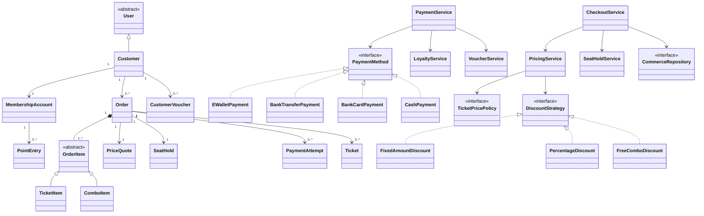

# Thiết kế OOP: đặt vé, thanh toán và thành viên N6 Cinema

Ngày khảo sát: 03/11/2026. Trạng thái: bản thiết kế đề xuất, chưa triển khai chức năng.

## 1. Phạm vi đã thống nhất

- Đồ án hướng đối tượng; giữ Java Spring Boot và giao diện HTML/CSS/JavaScript hiện có.
- Thanh toán mô phỏng, luôn ghi rõ giao dịch thử và không thu tiền thật.
- Trang đặt vé nhiều bước, trang tài khoản riêng; người dùng đã chọn hướng này thay cho mở rộng các hộp thoại hiện tại.
- Thiết kế trải nghiệm gần ứng dụng rạp phim: giữ ghế có thời hạn, combo bắp nước, ưu đãi, nhiều phương thức thanh toán, vé điện tử, lịch sử, điểm, voucher và hạng hội viên.
- Các ngưỡng hạng, điểm, thời hạn và ưu đãi dưới đây là đề xuất riêng của N6. Tham khảo nghiệp vụ từ các rạp; không sao chép nhận diện hoặc coi chính sách của họ là chính sách N6.
- Bản demo phục vụ một tiến trình ứng dụng. Thanh toán thật, nhiều máy chủ, hóa đơn điện tử hợp lệ, gửi SMS/email thật và xác minh giấy tờ thật nằm ngoài phạm vi này.

## 2. Khảo sát dự án và nguồn tham khảo

### 2.1. Hiện trạng trong repository

| Thành phần | Hiện có | Phần cần phát triển |
|---|---|---|
| `Frontend/welcome.html`, `welcome.js` | Chọn phim/suất/ghế trong dialog; xem từng vé; sửa thông tin | Checkout nhiều bước, trang tài khoản, trạng thái đầy đủ |
| `Frontend/booking.html` | Chuyển hướng về trang welcome | Trang checkout thực sự |
| `BookingService`, `BookingHandler` | Báo giá phía server, kiểm tra trùng ghế, đặt nhiều ghế, thanh toán tại quầy | Đơn hàng, giữ ghế có hạn, combo, thanh toán cả đơn |
| `Ticket`, `PaymentStatus` | Trạng thái thanh toán gắn trực tiếp với từng vé | Tách đơn, lần thanh toán, vé vào cửa và hoàn tiền |
| `PaymentMethod` và các implementation | Đa hình cơ bản; chuyển khoản/ví trả thành công ngay khi số tiền hợp lệ | Trả kết quả có trạng thái, xử lý chờ/huỷ/lỗi và chống xử lý lặp |
| `TicketPricePolicy` | NORMAL/STUDENT/VIP, dùng `BigDecimal` | Giữ Strategy; bổ sung ngữ cảnh, bảng giá và chính sách ưu đãi |
| `Customer extends User`, `Account` | Đã tách hồ sơ với thông tin đăng nhập | Thành viên, ngày sinh, điểm, voucher, tùy chọn và lịch sử |
| Repository JSON | Lưu riêng khách, tài khoản, vé, phim/phòng/suất | Ghi đồng bộ đơn–ghế–điểm–voucher, phục hồi sau khi khởi động lại |

`CustomerType.VIP` hiện là ưu đãi giá do admin cấp, chưa phải cấp hội viên dựa trên chi tiêu. Không được coi hai khái niệm này là một.

### 2.2. Điều học từ các hệ thống tham khảo

| Nguồn chính thức | Quan sát dùng làm căn cứ thiết kế |
|---|---|
| [CGV FAQ](https://www.cgv.vn/default/faq/) | Luồng chọn phim/rạp/suất/ghế, giữ ghế có thời hạn, xác nhận giao dịch; phân biệt điểm thưởng và chi tiêu xét hạng; có điều kiện hoàn vé |
| [Điều khoản CGV](https://www.cgv.vn/skin/frontend/cgv/default/html/pages/terms-of-use-vn.html) | Có nhóm phương thức thẻ, ví, QR/cổng thanh toán, voucher và điểm |
| [Chính sách thanh toán Beta](https://dev.cinemas.betacorp.vn/dieu-khoan/dieu-khoan-thanh-toan.htm) | Kiểm tra thông tin trước trả tiền; xử lý giao dịch chưa rõ kết quả và ngoại lệ khi suất bị hủy |
| [Chương trình app/thành viên Beta](https://dev.cinemas.betacorp.vn/khuyen-mai-moi/cai-app-beta-nhan-qua-bao-la.htm) | Tích lũy sau tiêu dùng, dùng điểm trong hóa đơn và phân hạng khách hàng |
| [VNPAY: kết nối thanh toán](https://sandbox.vnpayment.vn/apis/docs/thanh-toan-pay/pay.html) | Phân biệt trang trả kết quả cho trình duyệt với thông báo giao dịch về server; kiểm tra mã đơn, số tiền và xử lý lặp |
| [MoMo: Payment Notification](https://developers.momo.vn/v3/docs/payment/api/result-handling/notification/) | Thiết kế luồng thông báo kết quả thanh toán, có xác thực và đối soát |

Một số trang CGV/Beta không tải trực tiếp ổn định; phần khảo sát dùng cả nội dung công khai được công cụ tìm kiếm lập chỉ mục. Không sử dụng giá vé hay chương trình khuyến mại đang được lập chỉ mục làm cam kết hiện hành. Quy tắc N6 được định nghĩa độc lập ở các mục dưới.

## 3. Cấu trúc giao diện

| Đường dẫn đề xuất | Trách nhiệm |
|---|---|
| `/welcome.html` | Khám phá phim, lịch chiếu, ưu đãi, lối vào tài khoản |
| `/movie.html?id=...` | Poster, mô tả, thời lượng, định dạng/ngôn ngữ, phân loại tuổi, lịch chiếu |
| `/booking.html?showtimeId=...` | Năm bước checkout; lưu tiến trình trên server sau khi có giữ ghế |
| `/payment-demo.html?attemptId=...` | Trang thanh toán thử nội bộ, nhận diện rõ N6 Demo |
| `/order.html?id=...` | Kết quả, chi tiết đơn, vé điện tử và diễn biến thanh toán |
| `/account.html` | Tổng quan, lịch sử đặt vé, điểm, voucher, hội viên, hồ sơ và bảo mật |
| `/offers.html` | Danh sách/chi tiết ưu đãi và điều kiện sử dụng |
| `/admin.html` | Đơn, thu tiền tại quầy, hoàn tiền thử, voucher, quyền lợi và kiểm soát vé |

Trang checkout desktop dùng hai cột: bên trái là bước đang thao tác, bên phải là tóm tắt phim–suất–ghế–giá và đồng hồ giữ ghế. Mobile xếp một cột; thanh hành động dưới nội dung hiển thị tổng tiền và nút tiếp tục. Khi phóng to/thu nhỏ, bàn phím và thông báo không che mất nút thao tác.

Giữ phong cách cam/đen/kem hiện có. Ghế và trạng thái luôn có nhãn/ký hiệu bên cạnh màu. Form có lỗi ngay tại trường, hỗ trợ bàn phím và trạng thái tải/rỗng/thử lại.

## 4. Luồng đặt vé gồm năm bước

### Bước 1 — Chọn phim, ngày và suất

- Hiển thị ảnh phim, tên, thời lượng, phân loại tuổi, phụ đề/lồng tiếng và định dạng đã cấu hình.
- Chọn ngày trước, sau đó giờ; hiển thị phòng và giá từ. Dự án hiện có một rạp với nhiều phòng, không dựng bộ chọn tỉnh/thành giả khi chưa có dữ liệu cụm rạp.
- Suất đã qua, đã hủy hoặc ngừng bán không được chọn. Đề xuất ngừng bán online trước giờ chiếu 5 phút.
- Có nhắc yêu cầu độ tuổi và điều kiện ưu đãi sinh viên trước khi tiếp tục.
- Khách chưa đăng nhập vẫn xem được lịch và sơ đồ; yêu cầu đăng nhập trước khi giữ ghế. Đăng nhập xong quay lại đúng suất đã chọn.

### Bước 2 — Chọn và giữ ghế

- Có màn hình, lối đi, số hàng/cột, chú giải ghế thường/VIP/đôi và giá từng loại.
- Phân biệt: trống, đang chọn, mình đang giữ, người khác đang giữ, đã bán, bảo trì/ngừng sử dụng.
- Giới hạn đề xuất 1–8 vị trí ghế/đơn. Model hiện tại coi một vị trí `COUPLE` là một đơn vị vé có phụ phí; màn hình phải nói rõ. Ghế đôi theo cặp hai vị trí là mở rộng riêng, không tự suy ra từ tên loại ghế.
- Chọn trên màn hình chưa đồng nghĩa đã giữ. Bấm tiếp tục mới yêu cầu server giữ toàn bộ ghế; một ghế bị chiếm làm cả yêu cầu thất bại.
- Giữ trong 7 phút từ thời điểm server chấp nhận, tối đa tới thời điểm ngừng bán. Hiển thị `expiresAt` theo giờ server; tải lại trang không làm tăng hạn.
- Đổi ghế kiểm tra cả tập ghế trong cùng một thao tác: nhận được tập mới mới nhả ghế cũ, giữ nguyên hạn ban đầu. Đổi suất hủy lượt giữ hiện tại và xác nhận lại giá.
- Khi sắp hết hạn, hiện thông báo tại chỗ. Khi hết hạn, khóa trả tiền, nhả ghế và ưu đãi/điểm đang giữ, cho quay lại sơ đồ mới nhất.
- Đóng tab không phải bằng chứng hủy giữ ghế. Có nút hủy chủ động, đồng thời server có tác vụ dọn hạn và kiểm tra hạn trong mỗi lệnh ghi.

### Bước 3 — Chọn bắp nước

- Card sản phẩm có ảnh, tên, mô tả, giá, biến thể, số lượng và trạng thái còn bán.
- Có combo một người/hai người/gia đình; chọn vị bắp, cỡ/vị nước nếu sản phẩm hỗ trợ.
- Tối đa 5 combo mỗi đơn theo cấu hình. Được bỏ qua bước này.
- Mặc định nhận tại quầy bắp nước của rạp theo đơn vé; không có phí giao hàng.
- Server kiểm tra khả dụng và giá trước thanh toán, lưu tên/giá/biến thể vào đơn. Sửa giá sản phẩm sau đó không thay đổi đơn đã trả tiền.
- Bản đầu quản lý sản phẩm đang bán/ngừng bán, chưa mô phỏng kho nguyên liệu hoặc cam kết tồn kho số lượng hữu hạn.

### Bước 4 — Ưu đãi, thông tin nhận vé và thanh toán

- Kiểm tra lại tên phim, ngày/giờ, phòng, ghế, combo, họ tên, email/số điện thoại nhận vé.
- Chỉ rõ email chưa xác minh nếu chưa có quy trình xác minh; demo không thông báo đã gửi email thật.
- Chọn voucher hợp lệ từ ví hoặc nhập mã; cho biết lý do mã không áp dụng.
- Hiển thị điểm khả dụng, điểm có thể dùng, số tiền quy đổi và điểm dự kiến nhận.
- Bảng giá tách: vé cơ bản, phụ phí ghế, combo, ưu đãi được chọn, điểm sử dụng, còn phải thanh toán. Phí đặt vé mặc định 0đ; không bổ sung phí ẩn ở bước cuối.
- Ưu đãi theo phương thức trả tiền phải được tính lại khi đổi phương thức. Nếu tổng tiền thay đổi, khách phải xem và xác nhận lại trước khi bắt đầu giao dịch.
- Có liên kết điều kiện vé/hoàn tiền, checkbox chấp nhận và nút có số tiền: `Thanh toán thử 279.000đ`.
- Server mới là nơi chốt giá, quyền sở hữu, số dư điểm và điều kiện mã. Request không được quyết định `customerId`, giá cuối hoặc hạng của khách.
- Tạo đơn từ lượt giữ ghế, sau đó khóa ảnh chụp giá và quyền lợi. Trong lúc một lần trả tiền chưa rõ kết quả, không được mở thêm lần mới hoặc thay đơn.

### Bước 5 — Kết quả và vé điện tử

- Thành công: mã đơn, ngày giao dịch, phương thức thử, số tiền, vé/ghế, combo, điểm mới và voucher được cấp.
- Mã QR nhận vé/check-in phải chứa token ngẫu nhiên gắn với vé/đơn, không chứa thông tin cá nhân hoặc payload chuyển khoản ngân hàng.
- Có `Xem vé`, `Tải phiếu xác nhận demo`, `Về lịch sử`, hướng dẫn đến rạp. Phiếu có dấu demo, không gọi là hóa đơn điện tử hợp lệ.
- Đang xác minh: hiển thị đang xử lý, đồng bộ với server; không mời người dùng trả tiền thêm khi kết quả còn chưa xác định.
- Thất bại/khách hủy: nói rõ chưa trả tiền thành công; cho thử lại khi còn hạn.
- Mất mạng/đóng trang/tải lại: lấy trạng thái đơn từ server để khôi phục đúng màn hình.

## 5. Các hình thức thanh toán trong demo

Tất cả lựa chọn dưới đây đều thuộc mô phỏng nội bộ, không liên hệ cổng thật. Phương thức nào chưa được triển khai thì vô hiệu hóa và ghi rõ, không cho bấm rồi tự thành công.

| Lựa chọn | Giao diện và hành vi dự kiến |
|---|---|
| MoMo / ZaloPay / ShopeePay — mô phỏng | Chọn thương hiệu ví, chuyển trang thử của N6; xác nhận/hủy trong phiên demo |
| VNPAY-QR — mô phỏng | QR thử có payload `N6-DEMO`, số tiền, mã đơn và thời hạn; không phải mã nhận tiền ngân hàng |
| ATM/thẻ nội địa — mô phỏng | Chọn ngân hàng mẫu; xác nhận bằng dữ liệu thử có sẵn |
| Visa/Mastercard/JCB — mô phỏng | Chọn hồ sơ thẻ thử đã đặt tên; không yêu cầu nhập PAN/CVV/OTP thật |
| Chuyển khoản — mô phỏng | Nội dung chuyển khoản và trạng thái chờ giả lập; nút `Tôi đã chuyển` chỉ gửi yêu cầu kiểm tra, không đánh dấu đã thu tiền |
| Thanh toán tại quầy | Giữ chỗ có hạn; admin xác nhận thu tiền thử cả đơn. Phiếu chờ thanh toán không phải vé vào cửa |
| Điểm N6 + một phương thức khác | Trừ điểm trước số tiền còn lại; không tích điểm trên phần đã trả bằng điểm |

Với thanh toán tại quầy, đề xuất chỉ mở cho suất còn ít nhất 60 phút tại thời điểm chọn phương thức. Giới hạn một đơn chờ trả tại quầy/khách. Hạn được tính theo mốc cố định `holdCreatedAt`, không theo thời điểm bấm đổi phương thức:

- Online: `onlineDeadline = min(holdCreatedAt + 7 phút, giờ chiếu - 5 phút)`.
- Tại quầy: `counterDeadline = min(holdCreatedAt + 15 phút, giờ chiếu - 30 phút)`.
- Chỉ được chuyển phương thức khi đơn và lượt giữ hiện tại chưa hết hạn, không có lần thanh toán đang chờ xác minh. Server tính lại giá và cập nhật cùng lúc hạn giữ ghế, điểm và voucher; thay đổi không hợp lệ thì giữ nguyên phương thức cũ.
- Chuyển sang tại quầy trước hạn online được áp dụng mốc 15 phút đã tính sẵn, không cộng thêm 15 phút kể từ lúc đổi. Chuyển lại online chỉ hợp lệ nếu vẫn trước `onlineDeadline`; quá mốc này phải tiếp tục tại quầy hoặc hủy, không hồi sinh hạn online.
- Ví dụ: giữ lúc 10:00, online hết hạn 10:07; chọn tại quầy lúc 10:06 thì hạn là 10:15. Đổi về online lúc 10:08 bị từ chối, đơn tại quầy vẫn còn hạn 10:15. Nếu đơn online đã hết hạn lúc 10:07 thì không được đổi sang tại quầy lúc 10:08.
- Trường hợp lượt voucher không thể kéo dài theo điều kiện chiến dịch/phương thức mới, phải chọn lại ưu đãi và xác nhận giá trước khi chuyển. Không được giữ mức giảm cũ mà không còn quyền sử dụng.

Trang thử hiển thị cố định `MÔ PHỎNG — KHÔNG THU TIỀN`. Bộ điều khiển tình huống chỉ xuất hiện khi cấu hình demo bật và trong phiên do server cấp cho đúng khách/lần trả tiền:

1. Thành công ngay.
2. Bị từ chối/không đủ số dư thử.
3. Người dùng hủy.
4. Đang xử lý, sau đó thành công.
5. Hết hạn, sau đó nhận kết quả thành công muộn.
6. Server nhận kết quả hai lần hoặc nhận kết quả cũ sau lần thử mới.

Máy chủ ghi nhận sự kiện mô phỏng và xử lý trạng thái; UI không được gửi `paid=true` để sửa đơn trực tiếp. Kịch bản gửi lặp/sai thứ tự thuộc màn hình kiểm thử demo của admin, tách khỏi thao tác đặt vé thông thường.

Nếu tiền thử được ghi nhận sau khi hết hạn/đơn đã hủy: không lấy lại ghế của người khác, không phát vé, tạo hoàn tiền thử tự động và hiển thị tiến trình. Nhận hai giao dịch thành công cho cùng đơn: chỉ lần hợp lệ đầu cấp vé, lần thu dư được hoàn riêng.

## 6. Quy tắc giá, voucher và điểm

### 6.1. Thứ tự tính giá

1. Tính vé và phụ phí từng vị trí; tính combo/biến thể từ dữ liệu server.
2. Lập các phương án ưu đãi hợp lệ. Mặc định ưu đãi sinh viên, ưu đãi VIP cũ, ưu đãi hạng và voucher khuyến mại không cộng dồn; chọn phương án có lợi nhất cho cả đơn, có thể cho khách đổi phương án.
3. Mỗi ưu đãi có phạm vi vé/combo/toàn đơn, giá trị tối thiểu, trần giảm và quy tắc cộng dồn rõ ràng. Chỉ bật cộng dồn với chiến dịch đã cấu hình và được kiểm thử riêng.
4. Quy đổi điểm trên số tiền sau giảm. Số tiền còn lại không âm.
5. Chốt `PriceQuote` với phiên bản chính sách, thời hạn và chi tiết được lưu trong đơn. Giá dùng `BigDecimal`, VND nguyên đồng, quy tắc làm tròn xuống cho số điểm.

Nếu điểm/ưu đãi hợp lệ đã trả hết giá trị đơn, cho phép còn phải thu **0đ**, không ép khách chọn thêm phương thức trả tiền. Nút đổi thành `Xác nhận bằng điểm/ưu đãi`; server kiểm tra hạn giữ và quyền lợi rồi hoàn tất đơn trong một giao dịch. Ghi lần thanh toán nội bộ `LOYALTY`, phần tiền thu bằng 0, có snapshot điểm/ưu đãi; không gọi cổng thử và không ghi doanh thu tiền hay cấp điểm mới/chi tiêu xét hạng. Yêu cầu gửi lặp vẫn chỉ hoàn tất một lần. Khi hoàn đơn 0đ chỉ đảo quyền lợi tương ứng, không dựng giao dịch hoàn tiền ngoài hệ thống. Điểm không đủ phủ số tiền lẻ dưới 1.000đ thì vẫn cần trả phần lẻ bằng phương thức khác.

Ví dụ đề xuất, khách hạng Gold có 20 điểm khả dụng:

| Dòng tính | Số tiền |
|---|---:|
| 2 vé × 100.000đ | 200.000đ |
| 2 phụ phí VIP × 20.000đ | 40.000đ |
| Combo hai người | 89.000đ |
| Tạm tính | 329.000đ |
| Voucher giảm 30.000đ, đơn tối thiểu 250.000đ | −30.000đ |
| 20 điểm × 1.000đ | −20.000đ |
| Thanh toán thử còn lại | **279.000đ** |

Nếu giao dịch đủ điều kiện tích điểm Gold 5%, nhận `floor(279.000 × 5% / 1.000) = 13 điểm`. Chi tiêu xét hạng tăng 279.000đ; không tăng theo giá gốc 329.000đ.

### 6.2. Voucher và trang ưu đãi

- Voucher gồm hai phần: định nghĩa chương trình và quyền sở hữu/lượt sử dụng của khách. Không lưu một danh sách chuỗi mã trên `Customer` rồi xóa mã khi dùng.
- Hỗ trợ giảm số tiền cố định, phần trăm có trần, tặng combo. Voucher đổi vé/gift card có số dư thuộc giai đoạn mở rộng.
- Thuộc tính: mã, thời gian bắt đầu/kết thúc, số lượng toàn chiến dịch, lượt/khách, hạng, ngày/giờ, phim/suất/loại ghế, kênh bán, phương thức thanh toán và điều kiện giá trị đơn.
- Một đơn dùng tối đa một voucher khuyến mại theo mặc định. Voucher không đủ điều kiện vẫn có thể được xem, kèm lý do: chưa đến hạn, đã hết lượt, thiếu giá trị đơn, không đúng hạng hoặc phương thức.
- Giữ lượt voucher khi tạo đơn, chỉ ghi đã dùng khi trả tiền thành công. Hủy/hết hạn giải phóng lượt; hết thời hạn chiến dịch trong lúc đang thanh toán vẫn dùng được nếu lượt đã được server giữ hợp lệ tới hạn của đơn.
- Gợi ý các chương trình N6: `N6WELCOME30` giảm 30.000đ cho đơn đầu từ 250.000đ; `N6WEEKDAY10` giảm 10% vé ngày thường, tối đa 30.000đ; voucher combo sinh nhật; ưu đãi theo hạng. Tất cả là dữ liệu demo N6.
- Trang ưu đãi hiển thị điều kiện trước nút nhận/dùng; đã nhận không được nhận lặp. Điều kiện đơn đầu kiểm tra ở server trên lịch sử thanh toán ròng, có chống hoàn đơn rồi nhận lại.

### 6.3. Điểm và hạng hội viên đề xuất

| Hạng | Chi tiêu đủ điều kiện trong 365 ngày gần nhất | Tỷ lệ tích điểm | Quyền lợi mẫu |
|---|---:|---:|---|
| Member | Dưới 1.500.000đ | 3% | Ví voucher, quà chào mừng đủ điều kiện |
| Silver | Từ 1.500.000đ đến dưới 3.000.000đ | 4% | Voucher combo theo kỳ |
| Gold | Từ 3.000.000đ đến dưới 6.000.000đ | 5% | Voucher sinh nhật, chiến dịch riêng |
| Platinum | Từ 6.000.000đ | 7% | Gói voucher sinh nhật tốt hơn, ưu đãi theo hạng |

- Một điểm = 1.000đ; dùng tối thiểu 10 điểm/lần, theo đơn vị một điểm. Không dùng quá số dư khả dụng hoặc giá trị đơn; phần lẻ dưới 1.000đ thanh toán bằng phương thức khác.
- Điểm được cấp sau khi đơn trả tiền thành công, theo tỷ lệ của hạng được chụp lúc chốt giá. Đơn vừa giúp lên hạng không tự sửa ngược tỷ lệ của chính nó.
- Điểm dùng được trong 12 tháng từ lúc cấp. Tiêu điểm sắp hết hạn trước; hiển thị tổng khả dụng, đang giữ, hết hạn trong 30 ngày.
- Điểm đổi voucher chỉ bị trừ khi cấp voucher thành công; dùng khóa giao dịch chung để tránh mất điểm mà chưa nhận được voucher.
- Hạng tính từ chi tiêu đã thanh toán ròng sau hoàn tiền, không tính phần trả bằng điểm; xét lại sau thanh toán/hoàn tiền và tác vụ hàng ngày khi chi tiêu cũ ra khỏi cửa sổ 365 ngày.
- Điểm có thể còn dù hạng giảm. Người dùng nhìn thấy số tiền còn thiếu để lên hạng và phần chi tiêu sắp ra khỏi kỳ xét.
- Voucher sinh nhật/nâng hạng dùng khóa duy nhất khách–chương trình–kỳ, không cấp lặp khi chạy tác vụ hoặc lên/xuống hạng nhiều lần. Ngày sinh chỉ sửa theo quy trình có ghi lịch sử để tránh nhận quà nhiều lần.
- Ưu đãi sinh viên là điều kiện riêng, không phải hạng hội viên. Mã SV hiện chỉ được kiểm tra định dạng/trùng; UI không được nói đã xác minh trường học. Demo có trạng thái chờ duyệt/đã duyệt/từ chối/hết hạn do admin xử lý.
- Ưu đãi `CustomerType.VIP` cũ được bảo toàn như quyền lợi giá cũ 20%, tách khỏi hạng mới. Không tự cộng 20% với voucher hoặc ưu đãi khác.

## 7. Trang tài khoản khách hàng

| Mục | Nội dung và thao tác |
|---|---|
| Tổng quan | Thẻ thành viên, tên/mã/hạng, điểm, chi tiêu kỳ xét, tiến trình nâng hạng, vé sắp xem, voucher gần hết hạn |
| Lịch sử đặt vé | Lọc theo thời gian/trạng thái, tìm mã đơn/tên phim, sắp xếp mới nhất, phân trang |
| Chi tiết đơn | Vé/ghế/combo, bảng giá lịch sử, phương thức, các lần trả tiền, timeline và trạng thái hoàn |
| Vé điện tử | Mã vé/QR, ngày giờ, phòng, ghế; chỉ QR hợp lệ khi trả tiền, chưa sử dụng và chưa bị vô hiệu |
| Điểm N6 | Số dư khả dụng/đang giữ, lịch sử cộng–dùng–hoàn–hết hạn, đơn liên quan, quy tắc đổi điểm |
| Ví voucher | Tab có thể dùng/đang giữ/đã dùng/hết hạn; xem điều kiện, nhận mã, đổi điểm lấy voucher |
| Hội viên | So sánh quyền lợi, chi tiêu 365 ngày, khoản còn thiếu, lịch sử lên/xuống hạng và ưu đãi sinh viên |
| Hồ sơ | Họ tên, ảnh đại diện tùy chọn, ngày sinh, điện thoại, email, rạp/phim yêu thích khi có dữ liệu |
| Bảo mật và thông báo | Đổi mật khẩu, đăng xuất phiên; tùy chọn nhắc suất/voucher/khuyến mại và trạng thái xác minh |
| Hỗ trợ | Gửi yêu cầu gắn với đơn, lý do, trạng thái và phản hồi mẫu của admin |

Ví dụ tổng quan: `Gold · 235 điểm · Chi tiêu 365 ngày: 3.450.000đ · Còn 2.550.000đ để lên Platinum`. Bên dưới là vé sắp xem gần nhất, hai voucher sắp hết hạn và nút đến toàn bộ lịch sử.

Đặt lại từ lịch sử chỉ mở phim/suất còn bán và chọn lại ghế, không sao chép giá hay giữ lại ghế của đơn cũ. Đơn hủy/hoàn phải giữ lịch sử, không xóa khỏi danh sách. Đơn đã xem giữ phiếu xác nhận nhưng QR vào cửa bị vô hiệu.

Hồ sơ không chứa ô tự chọn hạng/VIP. Đổi email yêu cầu xác nhận mật khẩu và kiểm tra trùng; đổi mật khẩu không ghi log giá trị nhập. Khôi phục mật khẩu/xác minh email trong demo dùng hộp thư thử nội bộ, không thông báo đã gửi ra internet nếu chưa có nhà cung cấp thật.

## 8. Huỷ, hoàn và check-in

| Trường hợp | Xử lý N6 đề xuất |
|---|---|
| Đơn chưa trả tiền | Khách hủy hoặc tự hết hạn; nhả ghế, điểm và voucher đang giữ |
| Đang xác minh giao dịch | Không mở lần trả tiền mới; hủy được ghi yêu cầu chờ, khi có kết quả thành công chuyển hoàn tiền |
| Đã trả tiền, chưa dùng, trước suất ít nhất 60 phút | Khách gửi yêu cầu hoàn toàn bộ đơn; admin duyệt thử và hoàn về đúng phương thức thử |
| Đã dùng vé/nhận combo hoặc đã qua mốc hoàn | Không có nút tự hoàn; gửi yêu cầu hỗ trợ |
| Rạp hủy suất | Tạo hoàn toàn bộ các đơn chịu ảnh hưởng, thông báo trong tài khoản |
| Tiền thử đến muộn/thu dư | Hoàn riêng giao dịch thu muộn/thu dư; không cấp thêm vé hoặc cộng điểm |

Giai đoạn đầu chỉ hoàn cả đơn chưa sử dụng; chưa đổi suất/đổi ghế hoặc hoàn một phần. Khi yêu cầu hoàn, đặt cờ chặn check-in; khi từ chối bỏ cờ, khi chấp nhận vô hiệu vé và tạo tiến trình hoàn. Nếu hoàn thất bại vẫn giữ đơn ở trạng thái cần xử lý, không tự ghi đã hoàn.

Hoàn đủ số tiền thử đã thu; trả lại điểm đã dùng theo từng lô, với hạn mới tối thiểu 30 ngày nếu lô cũ đã hết hạn. Voucher dùng trong đơn được khôi phục một lượt nếu vẫn còn hạn, không phát sinh thêm bản sao. Đảo điểm đã tích và chi tiêu xét hạng đúng một lần. Nếu điểm thưởng đã được tiêu, giữ khoản điểm phải bù; điểm khả dụng không âm, điểm kiếm sau bù khoản này trước. Không trừ lại tiền hoàn của khách chỉ vì điểm đang thiếu.

Admin kiểm tra QR theo vé/đơn, xác nhận từng vé và combo độc lập. Quét lại chỉ trả trạng thái đã dùng và thời gian sử dụng; không sử dụng lần hai. Check-in và duyệt hoàn chạy trong cùng cơ chế khóa để không cùng thắng.

## 9. Thiết kế hướng đối tượng

### 9.1. Nguyên tắc áp dụng

- Đóng gói: thuộc tính thay đổi trạng thái để `private`; dùng phương thức nghiệp vụ kiểm tra điều kiện. Không cho controller tùy ý `setStatus(PAID)`.
- Trừu tượng và đa hình: phần tính giá, cách giảm giá và phương thức trả tiền dùng interface. Service gọi interface, không lặp `if/else` theo tên MoMo/ZaloPay ở mọi nơi.
- Kế thừa: giữ `Customer extends User` cho thông tin người dùng chung; `OrderItem` có hai loại dòng hàng vé và combo. Không tạo lớp con `VipCustomer`/`GoldCustomer` chỉ để biểu diễn hạng có thể thay đổi.
- Kết hợp đối tượng: khách có hồ sơ hội viên và sổ điểm; đơn gồm các dòng hàng và các lần thanh toán. Hạng là dữ liệu chính sách, không phải lớp người dùng mới.
- Trách nhiệm đơn: `Customer` không tự ghi JSON, trả tiền, tính voucher và gửi thông báo. Controller nhận request; domain giữ luật; service điều phối; repository lưu trữ.
- Dependency injection: nhận repository/policy/payment registry qua constructor; giảm các lệnh `new ...Repository()` bên trong service hiện có.
- Không cần tạo interface cho mọi lớp hoặc State class cho mọi enum. Chỉ tách interface ở nơi có nhiều hành vi, cần thay cách thực hiện hoặc cần thay bằng bộ nhớ trong lúc kiểm thử.
- Khi triển khai tuân thủ hướng dẫn repository: tên rõ nghĩa, hàm ngắn, không thêm docstring.

### 9.2. Các lớp và trách nhiệm chính

| Lớp/nhóm | Thuộc tính chính | Hành vi nghiệp vụ |
|---|---|---|
| `User` / `Customer` | ID, họ tên, liên hệ; điều kiện sinh viên/giá cũ | Cập nhật hồ sơ hợp lệ; giữ tương thích model hiện tại |
| `Account` | ID, hash mật khẩu, role, customerId | Nhận diện đăng nhập; không kiêm sổ điểm/hạng |
| `MembershipAccount` | customerId, mã hội viên, tier, kỳ xét | Xét hạng, tính khoảng cách tới hạng kế |
| `MemberTierPolicy` | Ngưỡng, tỷ lệ, quyền lợi cấu hình | Chọn hạng từ chi tiêu đủ điều kiện |
| `SeatHold` | ID, chủ sở hữu, suất, tập ghế, expiresAt, status | `isExpired`, `replaceSeats`, `release`, `consume` |
| `Order` | ID/mã, customerId, holdId, items, quote, contactSnapshot, status | `startPayment`, `confirmPayment`, `expire`, `requestRefund`; bảo vệ chuyển trạng thái |
| `OrderItem` abstract | itemId, tên lịch sử, số lượng, đơn giá | Tính thành tiền và mô tả dòng hàng |
| `TicketItem` | showtimeId, seatId, ảnh chụp phim/suất/ghế | Một vị trí/đơn vị vé; kiểm tra ghế và phụ phí |
| `ComboItem` | productId, biến thể, số lượng | Kiểm tra biến thể/số lượng, tính giá combo |
| `PriceQuote` immutable | Tiền gốc, các giảm giá, điểm, còn thu, version, expiresAt | Bảo toàn kết quả đã được server tính |
| `PaymentAttempt` | orderId, methodCode, requestId, amount, status, providerRef | Theo dõi một lần trả tiền và kết quả đã xác minh |
| `PaymentEvent` | eventId, attemptId, số tiền, kết quả, thời gian | Đầu vào thông báo; không tự sửa đơn |
| `Refund` | attemptId, orderId, số tiền, reason, status | Theo dõi hoàn đúng giao dịch, chống hoàn vượt thu |
| `Ticket` | orderId, seatId, tokenHash, useStatus | Cấp sau thanh toán; kiểm tra/sử dụng/vô hiệu QR |
| `VoucherCampaign` / `CustomerVoucher` | Luật chiến dịch / quyền sở hữu, hạn, lượt giữ/dùng | Kiểm tra điều kiện; giữ, tiêu, nhả và hoàn lượt |
| `PointEntry` / `PointReservation` | Chủ sở hữu, số điểm, loại, nguồn, hạn / đơn đang giữ | Lịch sử điểm bất biến; giữ điểm trước thanh toán |
| `Notification` | Người nhận, loại, đơn liên quan, đã đọc | Hộp thư tài khoản; demo gửi thành công không có nghĩa email thật |

`Order` là aggregate của các dòng hàng và giá đã chốt; `MembershipAccount` quản lý trạng thái hội viên thông qua sổ điểm. Liên hệ giữa chúng bằng ID, không sao chép toàn bộ `Customer` vào từng vé. Thông tin hiển thị tại thời điểm mua được chụp vào đơn để lịch sử không đổi theo danh mục hiện tại.

### 9.3. Sơ đồ lớp rút gọn

### 9.4. Đa hình dùng đúng chỗ

`PaymentMethod` đề xuất có `initiate(PaymentRequest)` trả `PaymentInitiation` và `verify(PaymentEvent)` trả `VerifiedPaymentResult`. Thay chữ ký `boolean pay(amount)` vì một boolean không mô tả được đang chờ, khách hủy hoặc kết quả đến muộn.

- `EWalletPayment`: nhận cấu hình MoMo/ZaloPay/ShopeePay; tái sử dụng `DemoScenarioEngine` cho tình huống thử.
- `BankTransferPayment`: cấu hình QR/cách chuyển khoản mẫu và kết quả chờ kiểm tra.
- `BankCardPayment`: mô phỏng nhóm thẻ nội địa/quốc tế bằng hồ sơ thử.
- `CashPayment`: xử lý xác nhận thử tại quầy, yêu cầu người thao tác có quyền quản trị ở application service.

Một `PaymentMethodRegistry` ánh xạ mã phương thức sang đối tượng đã được inject. `PaymentService` không biết chi tiết màn hình của từng ví, chỉ làm việc với request/kết quả chuẩn. Không tạo lớp riêng cho từng logo nếu chúng không có hành vi khác nhau.

Giữ `TicketPricePolicy` cho ưu đãi giá đang có. `DiscountStrategy` tính giá trị giảm của voucher; `VoucherEligibility` kiểm tra điều kiện trước khi tính. Các mã cùng giảm 30.000đ dùng cùng một strategy với cấu hình khác nhau, không phải một lớp/mã.

`MemberTierPolicy` giữ một bảng ngưỡng. `PointAccrualPolicy` tính điểm theo hạng và phần tiền đủ điều kiện. Điều chỉnh từ 5% lên 6% chỉ sửa chính sách, không sửa lớp `Customer`, controller và mã thanh toán đồng thời.

### 9.5. Phân lớp và service điều phối

| Tầng | Thành phần | Không đảm nhận |
|---|---|---|
| HTTP | Handler/controller, DTO, xác thực request | Không tính giá và ghi trạng thái giao dịch trực tiếp |
| Application | `CheckoutService`, `PaymentService`, `RefundService`, `AccountProfileService` | Không chứa HTML hoặc chi tiết parse JSON |
| Domain | `Order`, `SeatHold`, `Voucher`, chính sách giá/điểm/hạng | Không biết Spring HTTP, đường dẫn file hoặc trình duyệt |
| Infrastructure | Repository JSON, demo payment engine, clock, QR renderer | Không tự quyết định khách được giảm bao nhiêu |

`SeatHoldService` quản lý giữ/nhả ghế; `PricingService` xuất quote; `VoucherService` quản lý điều kiện và lượt; `LoyaltyService` quản lý sổ điểm và xét hạng. Tách trách nhiệm, đồng thời dùng chung một giao dịch lưu trữ cho những thay đổi cần nguyên tử.

Ví dụ gọi đa hình khi khách chọn MoMo: `CheckoutController → CheckoutService → PricingService → OrderRepository`, sau đó `PaymentController → PaymentService → PaymentMethodRegistry → EWalletPayment → DemoScenarioEngine`. Khi nhận sự kiện, `PaymentService` xác minh → kiểm tra đơn/hạn/số tiền → `Order.confirmPayment` → cấp vé, chốt voucher, cập nhật điểm → commit chung → trả kết quả.

## 10. Vòng đời và nhất quán dữ liệu

### 10.1. Trạng thái riêng cho từng đối tượng

| Đối tượng | Trạng thái đề xuất |
|---|---|
| Giữ ghế | ACTIVE, CONSUMED, RELEASED, EXPIRED |
| Đơn hàng | PENDING_PAYMENT, PAID, CANCELLED, EXPIRED, REFUND_PENDING, REFUNDED |
| Lần thanh toán | CREATED, PROCESSING, SUCCEEDED, FAILED, CANCELLED, EXPIRED |
| Hoàn tiền | REQUESTED, PROCESSING, SUCCEEDED, FAILED |
| Vé vào cửa | ISSUED, USED, VOID |
| Lượt voucher | AVAILABLE, RESERVED, USED, EXPIRED |

Một lần trả tiền thất bại không đồng nghĩa đơn bị hủy. Đơn có thể thử phương thức khác nếu còn hạn và lần cũ đã có kết quả cuối. Không cho một kết quả thất bại cũ ghi đè đơn đã trả tiền.

`PENDING_PAYMENT → PAID` chỉ diễn ra một lần sau xác minh hợp lệ. `PENDING_PAYMENT → CANCELLED/EXPIRED` nhả quyền giữ. `PAID → REFUND_PENDING → REFUNDED` theo luồng hoàn; nếu từ chối yêu cầu, quay lại PAID. Đơn hết hạn có khoản thu đến muộn vẫn không trở lại PAID; trạng thái tiền nằm trên `PaymentAttempt`/`Refund`, giao diện hiện rõ đang hoàn khoản thu muộn.

### 10.2. Lưu trữ phù hợp đồ án

Đề xuất giữ JSON để không thay nền tảng đồ án trong giai đoạn đầu. Phim, phòng, ghế, suất, hồ sơ và tài khoản tiếp tục dùng repository tương ứng. Riêng dữ liệu liên quan giao dịch mới dùng `commerce-state.json`: đơn, lượt giữ ghế, lần thanh toán, vé mới, voucher đã cấp/giữ/dùng, sổ điểm, khoản hoàn và sự kiện đã xử lý.

`CommerceRepository` cung cấp thao tác cập nhật nguyên tử. Implementation JSON tải trạng thái vào bộ nhớ, tạo bản sao khi thay đổi, khóa một tiến trình, kiểm tra bất biến, ghi snapshot vào file tạm cùng thư mục, thay file nguyên tử rồi mới công bố trạng thái mới trong bộ nhớ. Ghi thất bại thì không trả kết quả thành công và không công bố điểm/vé mới. Repository giả lập trong bộ nhớ giúp kiểm thử domain mà không cần chạy HTTP.

Không dùng nhiều thao tác ghi độc lập `tickets.json → points.json → vouchers.json` rồi coi đó là một giao dịch. JSON một tiến trình có giới hạn về kích thước và hiệu năng; khi mở rộng thực tế, thay implementation repository bằng database có transaction/unique constraint. Interface và domain giữ nguyên nghiệp vụ.

Tác vụ hết hạn dùng cùng repository và khóa với thao tác trả tiền. Lần thành công, sự kiện, cấp điểm, dùng voucher, hoàn tiền và check-in có khóa xử lý duy nhất theo nguồn để nhận thông báo lặp vẫn chỉ tạo một hiệu ứng.

### 10.3. Chuyển dữ liệu cũ

1. Sao lưu và kiểm tra dữ liệu trước khi chuyển; chạy thử migration ra thư mục riêng.
2. Ticket cũ không có orderId/thời điểm mua: tạo đơn lịch sử theo từng vé hoặc nhóm có căn cứ; không tự đoán các vé cùng khách là cùng một đơn. Đánh dấu nguồn legacy và thời điểm chưa xác định.
3. Vé SUCCESS cũ vẫn có quyền sử dụng theo chính sách hiện có; vé PENDING cũ chuyển thành giữ chỗ có hạn sau migration, có thông báo để không giữ ghế mãi.
4. Không tự cấp lại điểm/hạng cho hàng nghìn vé seed. Đánh dấu demo/legacy riêng, chỉ dữ liệu có căn cứ về số tiền và ngày trả mới được tính; seed mới có sổ điểm mẫu tương ứng rõ ràng.
5. Sau chuyển, mọi đọc/ghi vé và giữ ghế đi qua adapter/repository mới. Không để `TicketRepository` cũ tiếp tục ghi `tickets.json` song song.
6. Chặn admin xóa/sửa suất/ghế đang có giữ chỗ hoặc vé còn hiệu lực; hủy suất phải qua dịch vụ hủy–hoàn. Giá/tên hiển thị của đơn cũ lấy từ snapshot.

## 11. API dự kiến

Tên dưới đây là hợp đồng đề xuất; request/response chi tiết sẽ chốt ở kế hoạch triển khai.

| Nhóm | Endpoint chính |
|---|---|
| Danh mục | `GET /api/movies/{id}`, `GET /api/showtimes`, `GET /api/products` |
| Giữ ghế | `POST /api/seat-holds`, `GET /api/seat-holds/{id}`, `PUT /api/seat-holds/{id}/seats`, `DELETE /api/seat-holds/{id}` |
| Giá và tạo đơn | `POST /api/checkout/quote`, `POST /api/orders` |
| Đơn của khách | `GET /api/me/orders`, `GET /api/me/orders/{id}`, `POST /api/me/orders/{id}/cancel` |
| Thanh toán | `GET /api/payment-methods`, `POST /api/orders/{id}/payment-attempts`, `GET /api/payment-attempts/{id}` |
| Demo | `POST /api/demo/payment-attempts/{id}/confirm`, endpoint phát tình huống kiểm thử cho admin |
| Hoàn tiền | `POST /api/me/orders/{id}/refund-requests`, endpoint admin duyệt/từ chối/kiểm tra khoản hoàn |
| Vé/check-in | `GET /api/me/tickets/{id}`, `POST /api/admin/check-ins` |
| Hồ sơ | `GET/PUT /api/me/profile`, `POST /api/me/password-change` |
| Hội viên/điểm | `GET /api/me/membership`, `GET /api/me/points`, `GET /api/me/point-entries` |
| Voucher/ưu đãi | `GET /api/offers`, `GET /api/me/vouchers`, `POST /api/me/vouchers/claim`, `POST /api/me/reward-redemptions` |
| Thông báo/hỗ trợ | `GET /api/me/notifications`, `POST /api/me/support-requests` |

Mọi tài nguyên riêng phải kiểm tra chủ sở hữu từ session. Lệnh tạo đơn/thanh toán/hoàn dùng idempotency key có phạm vi khách + loại lệnh, lưu kết quả và đối chiếu payload. Cùng key khác payload bị từ chối. Không dùng CSRF token thay idempotency key. Các API ghi tiếp tục bảo vệ CSRF và phân quyền hiện có.

## 12. Những phần admin cần bổ sung

- Tìm đơn theo mã, khách, ngày/giờ và tình trạng; xem nhiều lần thanh toán thay vì một nhãn boolean.
- Xác nhận thu tiền thử cả đơn tại quầy; ghi người thao tác và thời gian, không có nút sửa giá/đổi chủ sở hữu tùy ý.
- Duyệt hoàn, theo dõi hoàn thử thất bại, nhận diện giao dịch thu dư/đến muộn.
- Danh mục combo/biến thể/giá và sản phẩm đang bán.
- Cấu hình chiến dịch voucher, giới hạn, hiệu lực, điều kiện và quyền lợi hạng.
- Xem sổ điểm, điều chỉnh bằng bút toán có lý do; không sửa/xóa lịch sử điểm trực tiếp.
- Duyệt ưu đãi sinh viên trong demo, tra cứu/quét vé và combo đã nhận.
- Báo cáo tách tổng tiền đơn, tiền thử đã thu, điểm đã dùng, giá trị khuyến mại và tiền thử đã hoàn; không cộng các lần thử thất bại vào doanh thu.

## 13. Kiểm thử chấp nhận

| Tình huống | Kết quả bắt buộc |
|---|---|
| Hai khách giữ cùng ghế đồng thời | Chỉ một lượt giữ thắng, không giữ một phần đơn |
| Tải lại trang hoặc mở hai tab | Cùng chủ sở hữu/cùng hạn; không nhân đôi lượt giữ |
| Hết hạn trong lúc trả tiền | Kết quả theo thời điểm commit server; thu muộn thì hoàn, không giành lại ghế |
| Lặp POST tạo đơn hoặc gửi kết quả hai lần | Một đơn hợp lệ, một lần cấp vé/điểm, một lượt dùng voucher |
| Thất bại rồi thành công ở lần thử khác | Lần cũ không ghi đè lần mới; không thu/cấp quyền lợi hai lần |
| Hai tab dùng cùng voucher/điểm | Không vượt lượt/số dư; thất bại/hủy trả lại đúng phần đang giữ |
| Đổi phương thức có ưu đãi riêng | Quote thay đổi, cần xác nhận lại, không giữ mức giảm sai |
| Chuyển online → quầy → online ở phút 6 và phút 8 | Quầy còn tới phút 15 từ mốc giữ đầu; từ chối quay online sau phút 7, không reset hạn |
| Đơn được điểm/ưu đãi phủ hết giá trị | Hoàn tất nội bộ đúng một lần, thu 0đ, không gọi cổng và không cấp điểm thưởng mới |
| Tắt ứng dụng rồi khởi động lại | Còn lịch sử đơn, lần trả tiền và điểm; lượt quá hạn được xử lý |
| Hỏng ghi file giữa nghiệp vụ | Không mất điểm/voucher mà chưa có đơn; không phát vé cho giao dịch chưa commit |
| Hoàn sau khi điểm thưởng đã tiêu | Một bút toán đảo, khoản phải bù rõ ràng; không sửa mất lịch sử |
| Đồng thời check-in và yêu cầu hoàn | Chỉ một hành động hợp lệ thắng; vé không vừa dùng vừa hoàn |
| Khách gọi ID đơn/voucher/điểm người khác | Bị từ chối dù đoán đúng ID |
| Ngưỡng hạng, hết hạn điểm, cuối ngày | Đúng mốc thời gian Asia/Ho_Chi_Minh, không cấp quà lặp |
| Chạy migration hoặc seed hai lần | Không nhân đôi đơn, điểm, voucher hoặc quyền hội viên |
| Desktop/mobile và bàn phím | Hoàn thành được năm bước, lỗi có nhãn rõ và không phụ thuộc màu |

## 14. Thứ tự triển khai đề xuất

1. **Domain và dữ liệu:** đơn hàng, giữ ghế, snapshot giá, repository giao dịch chung, migration, bảo toàn API cũ cần thiết. Hoàn tất các bất biến trước khi dựng thanh toán mới.
2. **Checkout:** trang năm bước, combo, giữ ghế đếm ngược, thanh toán thử đa hình, kết quả và QR. Có luồng thất bại/hết hạn ngay trong đợt này.
3. **Tài khoản:** lịch sử/chi tiết đơn, tổng quan, hồ sơ và bảo mật; liên kết dữ liệu thật của khách đang đăng nhập.
4. **Loyalty:** sổ điểm, xét hạng, voucher, ưu đãi, hoàn–đảo quyền lợi và màn hình admin tương ứng.
5. **Trình diễn và hoàn thiện:** seed theo từng kịch bản, kiểm thử đồng thời/khởi động lại, tài liệu UML, kịch bản thuyết trình và ảnh màn hình.

Mỗi đợt là một thay đổi có thể kiểm thử và commit riêng. Chỉ mở sang đợt sau khi các hành vi cốt lõi của đợt trước đã đúng; không dựng các con số điểm/hạng trên giao diện khi server chưa tính được.

## 15. Gợi ý trình bày OOP khi bảo vệ đồ án

1. **Đóng gói:** thử trả tiền cho đơn đã hết hạn; chính đối tượng/nghiệp vụ từ chối, controller không thể đổi trạng thái tùy ý.
2. **Kế thừa:** `Customer` dùng dữ liệu chung của `User`; `TicketItem` và `ComboItem` dùng chung cấu trúc `OrderItem`, nhưng có dữ liệu/kiểm tra riêng.
3. **Đa hình:** chọn ví, thẻ, chuyển khoản hoặc tiền mặt; cùng `PaymentService` gọi `PaymentMethod`, kết quả chuẩn hóa được xử lý thống nhất.
4. **Trừu tượng:** chạy cùng nghiệp vụ với repository bộ nhớ trong kiểm thử và repository JSON khi trình diễn.
5. **Strategy và composition:** thay chính sách điểm/voucher bằng cấu hình/đối tượng, không đổi lớp khách; khách vừa là sinh viên vừa có hạng Gold.
6. **Tính đúng nghiệp vụ:** hai cửa sổ giành ghế, giao dịch đến muộn và hoàn điểm chứng minh mô hình không chỉ có CRUD.
